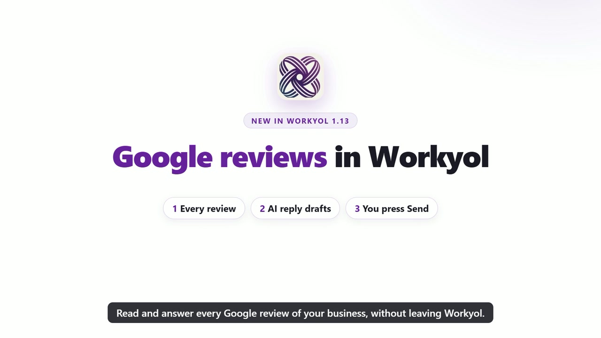

# Google reviews skill for Claude

Answer your Google reviews from Claude, in each reviewer's language, with a draft you check before it is posted. Schedule Google posts and see how many people found you on Google Search and Maps.



## What it does

- **Reviews:** lists the reviews of your Google Business Profile, for every location, newest first, with Google's translation. Filters: unanswered, all, or 1 to 3 stars.
- **Replies:** Claude drafts a short, personal reply in the language of each review (French, Arabic, Turkish, English, dialects…). You read it, change it if you want, and say yes. Only then is it posted.
- **Bad reviews:** a calm public answer, plus a private note on what to fix.
- **More reviews:** a short request with your own Google review link, to share with every customer (no gifts, no picking only happy customers: Google forbids it).
- **Google posts:** offers, events and news on your Google profile, with a Call now, Book or Order button, scheduled for one or all locations.
- **Numbers:** views on Search and Maps, calls, website clicks, direction requests and new reviews, per location and per month.
- **Agencies:** each client has its own Google connection; ask by client name.

## Official API

It uses Google's official **Business Profile API** through **Workyol**, a program that runs on your computer. Workyol never sees your Google password, and the assistant never sees your access tokens. Workyol is not made or endorsed by Google.

## What you need

- The **Workyol app** (1.14 or later), installed and running on your computer (Windows, Mac or Linux). Free 7-day trial: https://workyol.com/?ref=skill-google-reviews
- An AI assistant that supports skills and MCP servers (Claude Code, Claude Desktop, claude.ai).
- In Workyol: **Google reviews → Connect Google Business Profile**, with the Google account that owns or manages your business.

This skill is free and MIT-licensed. The app has its own licence. For WhatsApp, Instagram, Messenger, LinkedIn and Reels too, see the full [Workyol skill](https://github.com/afrikyol/workyol-skill).

## Install the skill

**Claude Code**

```
git clone https://github.com/afrikyol/google-reviews-skill.git ~/.claude/skills/google-reviews
```

**Claude Desktop / claude.ai**

Zip the folder (the zip must contain `SKILL.md`). Go to Settings, Capabilities, Skills, and upload the zip.

## Connect the MCP server

In Workyol: **Connections**, then the tab **AI assistants (Claude, ChatGPT…)**, then **Connect** next to your app. Restart that app once. Workyol must stay open while the assistant works.

For Claude Code, the command looks like this (change the path to your Workyol folder):

```
claude mcp add workyol --scope user -e WORKYOL_URL=http://127.0.0.1:4747 -- node "C:\path\to\Workyol\mcp\workyol-mcp.js"
```

**Tip:** start your request with "First load the google-reviews skill, then…" to get its step-by-step guide and reply rules.

## Example prompts

- Show my unanswered Google reviews and draft a reply to each, in the reviewer's language.
- We got a 2-star review about waiting time. Help me answer it.
- Write a short message with our Google review link for our receipts.
- Schedule a Google post for all my locations on Friday at 09:00 with a Call now button.
- How many people found us on Google Maps last month, and how many called?

## Safety

- Nothing is posted until you say yes. Replies are public on Google, so the assistant shows every draft first.
- No fake reviews, no rewards for reviews, no review gating.
- The assistant never sees your Google password, access tokens or licence key.

## Licence

MIT, Copyright (c) 2026 Afrikyol, LLC.

---

## Français

Répondez à vos avis Google depuis Claude, dans la langue de chaque client, avec une réponse proposée que vous validez avant publication. Programmez des publications Google et voyez combien de personnes vous ont trouvé sur Google Search et Maps. API officielle Google Business Profile, via l'application Workyol. Rien n'est publié sans votre accord.
Application et essai gratuit : https://workyol.com/?ref=skill-google-reviews

## Türkçe

Google yorumlarınızı Claude ile, her müşterinin dilinde yanıtlayın; yanıt taslağı siz onaylamadan yayınlanmaz. Google gönderileri zamanlayın, Google Search ve Maps'te sizi kaç kişinin bulduğunu görün. Google Business Profile resmi API'si, Workyol uygulaması ile. Siz onaylamadan hiçbir şey yayınlanmaz.
Uygulama ve ücretsiz deneme: https://workyol.com/?ref=skill-google-reviews

## العربية

ردّ على تقييمات Google من Claude بلغة كل عميل، مع رد مقترح تراجعه قبل النشر. جدول منشورات Google واعرف عدد من وجدك على Google Search وMaps. عبر واجهة Google Business Profile الرسمية وتطبيق Workyol. لا يُنشر شيء قبل موافقتك.
التطبيق وتجربة مجانية: https://workyol.com/?ref=skill-google-reviews
